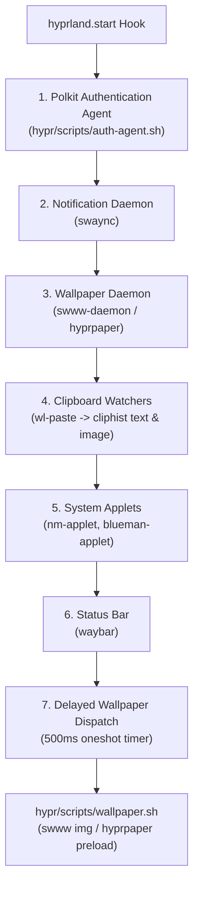

# Autostart & Wallpaper Framework

Obsyx provides a deterministic, resilient shell autostart architecture and canonical wallpaper asset management designed to ensure reliable desktop session bootstrap.

## Overview

During session initialization, Hyprland executes `hypr/config/autostart.lua` via the `hyprland.start` lifecycle hook. Services are started in an ordered sequence to avoid race conditions (e.g. between the notification daemon, authentication agent, wallpaper daemons, and Waybar's tray modules).



## Startup Order & Registry Configuration

All autostarted binaries and scripts are centrally configured in `Registry.Startup` inside `hypr/config/variables.lua`:

| Component | Registry Key | Default Command | Description |
|-----------|--------------|-----------------|-------------|
| **Auth Agent** | `Registry.Startup.authAgent` | `~/.config/hypr/scripts/auth-agent.sh` | Discovers & runs Wayland Polkit agent (`hyprpolkitagent`, `polkit-gnome`, etc.) |
| **Notification Daemon** | `Registry.Startup.notificationDaemon` | `swaync` | SwayNC notification center daemon |
| **Wallpaper Daemon** | `Registry.Startup.wallpaperDaemon` | `swww-daemon` | Active wallpaper daemon (supports `swww-daemon` or `hyprpaper`) |
| **Wallpaper Setter** | `Registry.Startup.wallpaper` | `~/.config/hypr/scripts/wallpaper.sh` | Applies wallpaper with fade transitions or IPC |
| **Clipboard (Text)** | `Registry.Startup.clipboardText` | `wl-paste --type text --watch cliphist store` | Text history watcher |
| **Clipboard (Image)** | `Registry.Startup.clipboardImage` | `wl-paste --type image --watch cliphist store` | Image history watcher |
| **Network Applet** | `Registry.Startup.networkApplet` | `nm-applet` | NetworkManager tray applet |
| **Bluetooth Applet** | `Registry.Startup.bluetoothApplet` | `blueman-applet` | Blueman tray applet |
| **Status Bar** | `Registry.Startup.statusBar` | `waybar` | Modular status bar |

## Wallpaper Framework

### Canonical Wallpaper Assets

Obsyx ships with canonical wallpaper assets aligned with the Noctis Amethyst design tokens:

- **SVG Source**: `assets/wallpapers/noctis_amethyst_default.svg` (scalable vector artwork using `#121018`, `#8a63d2`, `#c7a6ff`, `#9b7ede`, and `#dacbff`).
- **Rendered Asset**: `assets/wallpapers/noctis_amethyst_default.png` (high-fidelity 1920x1080 8-bit RGBA).

### Daemon Support

1. **`swww` (Default)**:
   - High-performance daemon with hardware-accelerated transitions.
   - Initialized via `swww-daemon`.
   - Dispatched by `hypr/scripts/wallpaper.sh` using:
     ```bash
     swww img "$WALLPAPER" --transition-type fade --transition-duration 1.5 --transition-fps 60
     ```

2. **`hyprpaper` (Alternative)**:
   - Official Hyprland wallpaper utility.
   - Configured via `hypr/hyprpaper.conf`:
     ```ini
     preload = ~/.config/hypr/assets/wallpapers/noctis_amethyst_default.png
     wallpaper = ,~/.config/hypr/assets/wallpapers/noctis_amethyst_default.png
     ```
   - Dispatched dynamically via IPC:
     ```bash
     hyprctl hyprpaper preload "$WALLPAPER"
     hyprctl hyprpaper wallpaper ",$WALLPAPER"
     ```

### Path Fallback Resolution

`hypr/scripts/wallpaper.sh` safely resolves wallpaper sources in descending priority:
1. Explicit CLI argument (`$1`).
2. User override at `~/Pictures/Wallpapers/default.png`.
3. Repository local asset at `assets/wallpapers/noctis_amethyst_default.png`.
4. Installed user configuration at `~/.config/hypr/assets/wallpapers/noctis_amethyst_default.png`.

## Polkit Authentication Launcher

`hypr/scripts/auth-agent.sh` prevents duplicate instances and searches across standard Wayland Polkit agents:
1. `hyprpolkitagent.service` (systemd user service).
2. `/usr/lib/hyprpolkitagent/hyprpolkitagent` (Hyprland official agent binary).
3. `/usr/lib/polkit-gnome/polkit-gnome-authentication-agent-1`.
4. `/usr/lib/polkit-kde-authentication-agent-1`.
5. `lxpolkit`.
