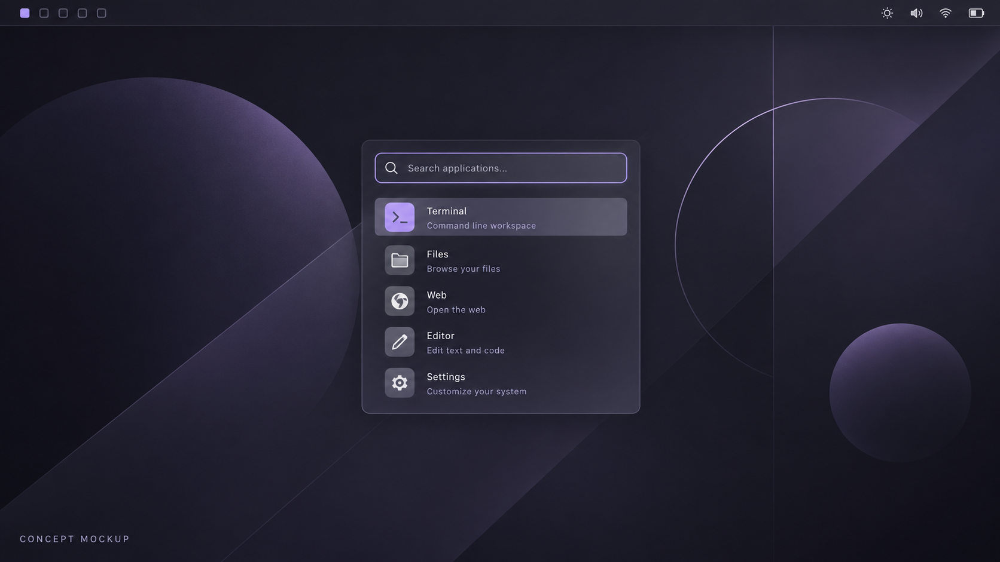
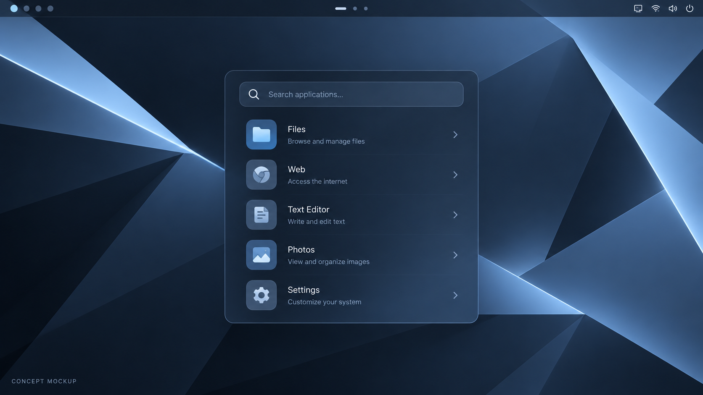
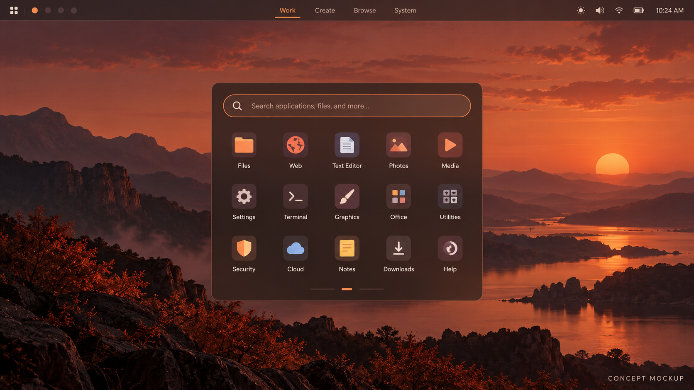
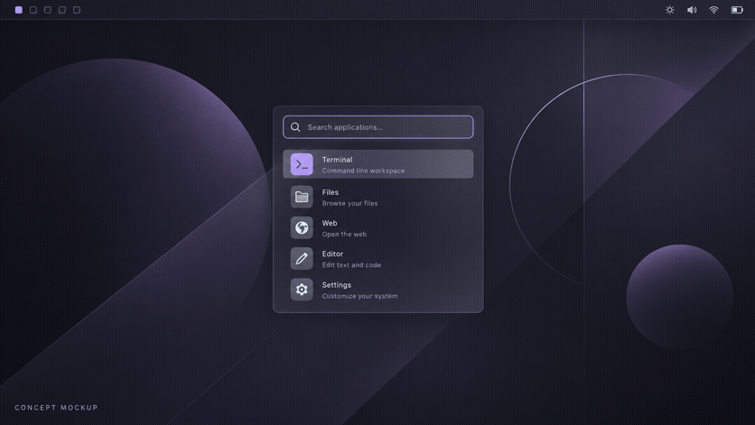

# Desktop mockups and GIF demonstrations

These generated visuals are **concept mockups**, not screenshots or recordings of a running Obsyx session. They illustrate the intended desktop composition and palette variations; they do not prove that each application, module, or animation works at runtime.

## Desktop and launcher concept

## Palette concepts

## Theme palette cycle

The GIF cycles through Noctis-style plum, Frost-style blue, and Ember-style warm palettes. The frames are independently generated mockups; they are not a capture of `obsyx theme apply` or a live transition.

For actual behavior, see the [CLI commands](cli.md) and [theme implementation notes](themes.md). Real session captures can replace these concepts when a reproducible capture environment is available.
