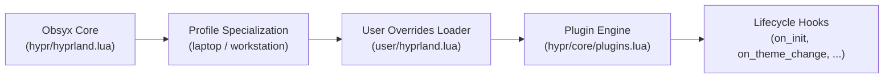

# Obsyx User Overrides Framework

The `user/` directory provides a **Git-clean extension point** for personalizing your Obsyx desktop environment without modifying tracked files or creating git merge conflicts when updating Obsyx.

---

## How It Works

Local files matching `user/*.lua` or `user/*.jsonc` are ignored by Git. They do not appear as untracked changes, and ordinary updates will leave them in place. As with any ignored local file, an upstream change that starts tracking the same path may require you to move your local file before updating.



---

## 1. Hyprland Customization (`user/hyprland.lua`)

To customize keybindings, applications, window rules, or register custom plugins:

1. Copy the example configuration:
   ```bash
   cp user/hyprland.lua.example user/hyprland.lua
   ```
2. Edit `user/hyprland.lua` to add your customizations.
3. Obsyx automatically discovers and loads `user/hyprland.lua` during compositor bootstrap.

### Lifecycle Hooks & Plugins

You can register plugins and hook directly into compositor lifecycle events:

```lua
local Plugins = require("core.plugins")

Plugins.register("my_workflow", {
    on_init = function()
        print("Obsyx desktop initialized!")
    end,

    on_theme_change = function(theme, theme_name)
        print("Active theme changed to: " .. tostring(theme_name))
    end,

    on_profile_change = function(profile_name)
        print("Hardware profile changed to: " .. tostring(profile_name))
    end,

    on_workspace_change = function(workspace_id)
        print("Switched to workspace: " .. tostring(workspace_id))
    end,
})
```

---

## 2. Waybar Customization (`user/waybar.jsonc`)

To customize status bar modules, layouts, or geometry:

1. Copy the example Waybar configuration:
   ```bash
   cp user/waybar.jsonc.example user/waybar.jsonc
   ```
2. When `user/waybar.jsonc` is present, Obsyx automatically directs Waybar to launch using `waybar -c user/waybar.jsonc`.

---

## 3. Alternative XDG Storage

If you prefer keeping user configs outside the repository tree, Obsyx also searches for user overrides in:
- `~/.config/obsyx/user/hyprland.lua`
- `~/.config/obsyx/user/waybar.jsonc`
